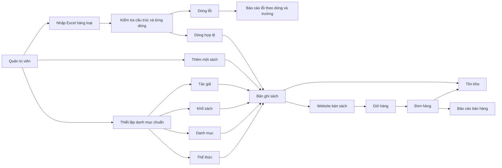
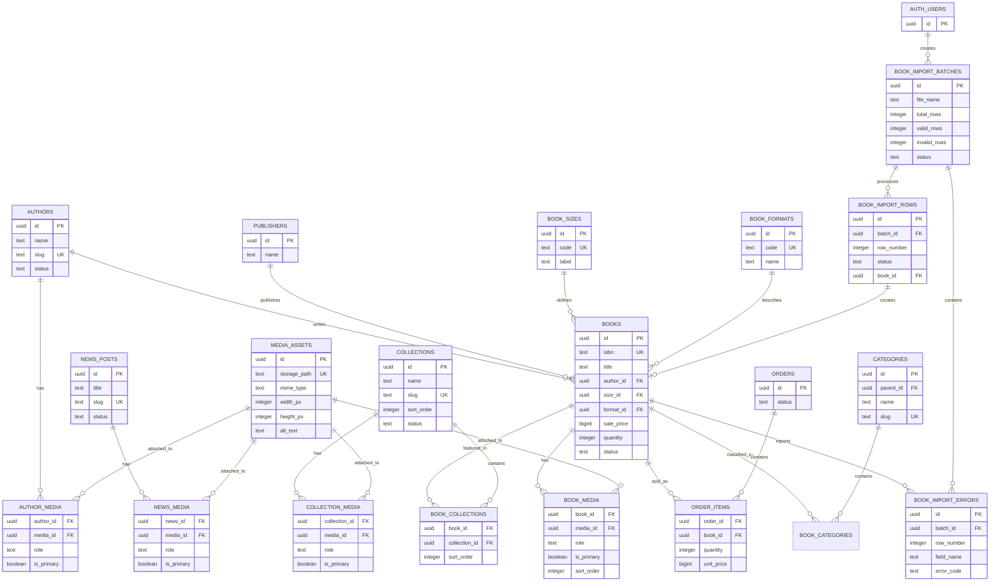

# Linery Admin – Phân tích nghiệp vụ quản lý catalog v0.1

## 1. Mục tiêu

Xây dựng khu vực quản trị để nhân viên Linery có thể quản lý dữ liệu sách có cấu trúc, dùng được cho storefront, tìm kiếm, tồn kho, đơn hàng và nhập dữ liệu hàng loạt.

Tài liệu này là cơ sở trước khi tiếp tục làm màn hình. Prototype hiện tại ở `/admin/books` chỉ là bản minh họa; chưa được xem là nguồn dữ liệu chính thức.

## 2. Phạm vi quản lý

### 2.1. Quản lý sách

Một bản ghi sách cần có:

| Nhóm | Trường | Bắt buộc | Quy tắc |
|---|---|---:|---|
| Nhận diện | Tên sách | Có | Không rỗng; dùng để tạo slug nhưng slug phải unique |
| Nhận diện | ISBN | Có | Bắt buộc và unique; không tự thêm dấu cách |
| Quan hệ | Tác giả | Có | Chọn tác giả đã có hoặc tạo mới theo quyền |
| Quan hệ | Nhà xuất bản | Không | Chọn từ danh mục nhà xuất bản |
| Phân loại | Danh mục | Không | Có thể chọn nhiều danh mục |
| Xuất bản | Thể thức | Không | Ví dụ Paperback, Hardcover, Digital |
| Xuất bản | Khổ sách | Có | Chọn từ danh mục khổ sách chuẩn |
| Kho | Số lượng tồn | Không | Mặc định 0; nếu nhập phải là số nguyên từ 0 trở lên |
| Giá | Giá bán | Không | Có thể để trống khi lưu nháp; nếu nhập phải là số tiền không âm |
| Giá | Đơn giá nhập | Không | Số tiền không âm |
| Nội dung | Mô tả, ảnh bìa, gallery | Không | Một sách có thể có nhiều ảnh; phải có ảnh chính, thứ tự, alt text và asset được quản lý |
| Trạng thái | Trạng thái bán | Có | Nháp, đang bán, hết hàng, lưu trữ |

### 2.2. Quản lý tác giả

- Tên hiển thị, slug, tiểu sử, ảnh đại diện.
- Có thể gắn một tác giả với nhiều sách.
- Không xóa cứng tác giả đã có sách; dùng trạng thái lưu trữ.

### 2.3. Quản lý danh mục

- Danh mục có tên, slug, mô tả, trạng thái và danh mục cha tùy chọn.
- Cho phép một sách thuộc nhiều danh mục.
- Không cho phép trùng slug trong cùng phạm vi.
- Không xóa cứng danh mục đang được sách sử dụng.

### 2.4. Quản lý thể thức và khổ sách

Tách hai khái niệm:

- **Thể thức**: Paperback, Hardcover, Digital, Audiobook.
- **Khổ sách**: kích thước thành phẩm như `13 × 20 cm`, `14 × 20.5 cm`, `16 × 24 cm`.

Mỗi danh mục có tên hiển thị, mã ổn định, thông tin mô tả và trạng thái hoạt động. Không dùng text tự do trong bảng sách nếu giá trị thuộc danh mục chuẩn.

### 2.5. Collection và nội dung hiển thị

Trang chủ đang có các mô-đun tuyển chọn như `NEW & UPCOMING`, `LINERY PRESS`, `LINERY PICKS`. Đây là collection biên tập, không phải danh mục thể loại. Một sách có thể thuộc nhiều collection; collection cần có thứ tự hiển thị, trạng thái và khoảng thời gian xuất bản nếu là collection theo mùa.

### 2.6. Quản lý hình ảnh và media

Ảnh là dữ liệu dùng chung, không gắn cố định một đường dẫn trong từng bảng:

- Một sách có nhiều ảnh: `cover`, `gallery`, `og`.
- Một tác giả có nhiều ảnh: `portrait`, `gallery`, `og`.
- Một collection hoặc banner có nhiều ảnh: `banner`, `mobile_banner`, `gallery`, `og`.
- Một bài viết tin có nhiều ảnh: `hero`, `content`, `og`.
- Mỗi nhóm ảnh có một ảnh chính, thứ tự hiển thị và alt text riêng.
- Ảnh được upload vào Supabase Storage; database chỉ lưu metadata và đường dẫn storage.
- Khi xóa ảnh khỏi item, ưu tiên lưu trữ mềm để không làm hỏng nội dung cũ hoặc cache SEO.
- File Excel không nhúng binary image. Excel chỉ nhận `asset_id` hoặc URL đã được cấp quyền; upload ảnh thực hiện ở bước quản lý media.

Thông tin tối thiểu của một media asset: tên file, storage path, MIME type, dung lượng, chiều rộng, chiều cao, alt text, trạng thái và người upload.

### 2.7. Quản lý điểm bán

Điểm bán không chỉ là một địa chỉ; cần phân biệt kênh bán và địa điểm thực tế:

- Kênh bán: website Linery, cửa hàng, đối tác, sàn thương mại điện tử.
- Điểm bán: mã điểm bán, tên, loại, địa chỉ, số điện thoại, giờ hoạt động, trạng thái.
- Một điểm bán có thể có tồn kho riêng.
- Đơn hàng phải ghi nhận kênh bán và điểm xử lý/giao hàng.
- Không xóa cứng điểm bán đã phát sinh đơn; chỉ đóng hoặc lưu trữ.

### 2.8. Quản lý khách hàng

- Hồ sơ khách: tài khoản, họ tên, email, số điện thoại, ngôn ngữ, trạng thái.
- Nhiều địa chỉ giao hàng; một địa chỉ có thể đánh dấu mặc định.
- Lịch sử đơn hàng, thanh toán, hoàn trả và ghi chú chăm sóc khách hàng.
- Quản lý đồng ý nhận email/marketing và thời điểm đồng ý.
- Không lưu mật khẩu trong bảng khách hàng; xác thực dùng Supabase Auth.
- Nhân viên chỉ xem dữ liệu khách theo quyền; số điện thoại/email cần được bảo vệ trong log.

### 2.9. Cấu hình hệ thống và nội dung storefront

Admin cần cấu hình được mà không sửa code:

- Logo header, logo footer, favicon và ảnh chia sẻ mặc định.
- Banner trang chủ: nhiều banner, desktop/mobile, thứ tự, liên kết, thời gian hiển thị, trạng thái.
- Nội dung footer: giới thiệu, địa chỉ, điện thoại, email, giờ mở cửa, mạng xã hội, liên kết chính sách.
- Nội dung các khu vực cố định: thông báo, tagline, CTA, banner collection.
- Cấu hình theo ngôn ngữ nếu website có English/Vietnamese.
- Xem trước trước khi xuất bản; có trạng thái nháp, xuất bản, lưu trữ.

Không lưu các nội dung này dưới dạng text hard-code trong React. Logo/banner/footer phải tham chiếu tới media asset hoặc content block có ID ổn định.

### 2.10. Quản lý địa điểm và địa chỉ

- Danh mục địa giới: quốc gia, tỉnh/thành, quận/huyện, phường/xã.
- Địa điểm điểm bán, kho, địa chỉ khách hàng và địa chỉ giao hàng đều tham chiếu cùng một bộ dữ liệu chuẩn.
- Lưu snapshot địa chỉ trong đơn hàng để địa chỉ cũ không bị thay đổi khi danh mục địa giới cập nhật.
- Cho phép bật/tắt khu vực giao hàng và phí giao hàng theo khu vực.

### 2.11. Cấu hình Gemini AI chatbot

Admin cần quản lý chatbot như một kênh hỗ trợ, nhưng không được nhìn thấy hoặc sửa trực tiếp secret API:

| Nhóm | Cấu hình |
|---|---|
| Hiển thị | Bật/tắt bot, tên bot, tagline, ảnh/icon bot, lời chào mở đầu |
| Nội dung | System prompt, ngôn ngữ trả lời, câu trả lời fallback, thông báo khi chưa kết nối catalog |
| Tính năng | Tìm sách, tìm tác giả, tra cứu đơn hàng, nhận diện ảnh bìa, upload ảnh |
| Gợi ý | Danh sách quick prompts như “Find a book”, “Track an order” |
| Mô hình | Provider, model, temperature, giới hạn token, timeout |
| An toàn | Giới hạn số lượt, giới hạn kích thước ảnh, MIME được phép, lọc nội dung, thời gian lưu log |
| Vận hành | Trạng thái kết nối, thời điểm cập nhật, người cập nhật, lỗi gần đây |

API key Gemini phải nằm trong secret/environment của backend hoặc Cloudflare Function, không được dùng `VITE_GEMINI_API_KEY` trong bundle frontend production. Chatbot phải gọi backend để backend kiểm soát quyền, rate limit, catalog search và dữ liệu đơn hàng.

### 2.12. Đối chiếu Footer hiện tại với cấu hình admin

Footer hiện tại đang có các nội dung sau và tất cả cần đưa vào cấu hình:

- Tên thương hiệu: `LINERY`.
- Phiên âm và tagline: `(pn.) /'lıməri/` và mô tả bookstore/independent press.
- Hotline: số điện thoại và `tel:` link.
- Địa chỉ: Hanoi Book Street, Cua Nam Ward, Hanoi.
- Email và `mailto:` link.
- Nhãn `Follow Us`.
- Social links: Instagram, Facebook, TikTok, Threads.
- Ảnh minh họa footer và alt text.
- Các liên kết chính sách: Terms, Privacy Policy, Shipping, Returns; hiện footer chưa hiển thị đầy đủ và cần bổ sung vào content settings.

Mỗi social link nên có platform, label, URL, icon key, thứ tự và trạng thái. Không hard-code URL trong component Footer.

### 2.13. Cấu hình phương thức thanh toán và tài khoản nhận tiền

Checkout hiện tại đang có các phương thức cần đưa vào admin:

- Chuyển khoản ngân hàng.
- VNPay.
- MoMo.
- Apple Pay.
- ZaloPay.

Admin cần cấu hình được:

| Nhóm | Trường |
|---|---|
| Phương thức | Mã, tên hiển thị, loại, icon/media, thứ tự, bật/tắt |
| Ngân hàng | Tên ngân hàng, chi nhánh, số tài khoản, tên người nhận |
| QR | Ảnh QR, alt text, tài khoản liên kết, trạng thái |
| Chuyển khoản | Nội dung chuyển khoản mẫu, hướng dẫn, thời gian giữ đơn |
| Gateway/wallet | Public merchant ID, môi trường sandbox/production, hướng dẫn hiển thị |
| Vận hành | Tài khoản mặc định, thời gian áp dụng, người cập nhật, lịch sử thay đổi |

Quy tắc bảo mật:

- API key, secret key, webhook secret và private credential không lưu trong bảng hiển thị cho admin thông thường.
- Secret phải nằm trong Supabase Vault, Cloudflare Secrets hoặc secret manager tương đương; database chỉ lưu `secret_ref`.
- Số tài khoản ngân hàng là dữ liệu nhạy cảm, phải giới hạn quyền xem và không ghi vào log frontend.
- Đơn hàng phải snapshot phương thức thanh toán và thông tin nhận tiền tại thời điểm tạo đơn để sau này đổi tài khoản không làm sai lịch sử.
- Mọi webhook thanh toán phải được xác thực chữ ký, chống gửi trùng và ghi nhận lịch sử trạng thái.

## 3. Nhập sách hàng loạt

### 3.1. Quy trình

1. Người dùng tải file mẫu từ màn hình quản trị.
2. File có sheet `Sách` và sheet `Hướng dẫn`.
3. Người dùng điền từng dòng, mỗi dòng là một sách.
4. Hệ thống nhận file, tạo một import batch và kiểm tra cấu trúc cột.
5. Hệ thống kiểm tra từng dòng độc lập.
6. Dòng hợp lệ được ghi nhận; dòng lỗi không chặn các dòng hợp lệ khác.
7. Hệ thống trả báo cáo gồm tổng dòng, số dòng thành công, số dòng lỗi và lỗi theo dòng/trường.
8. Người dùng tải báo cáo lỗi, sửa file gốc và nhập lại.

### 3.2. Bộ trường bắt buộc khi nhập

Bốn trường bắt buộc duy nhất ở V0.1 là: **Tên sách, ISBN, Tác giả, Khổ sách**. Các trường còn lại có thể để trống khi tạo bản ghi nháp; hệ thống áp dụng quy tắc riêng khi chuyển sách sang trạng thái đang bán.

### 3.3. Lỗi cấu trúc file

Nếu thiếu sheet `Sách`, thiếu cột bắt buộc hoặc sai định dạng file, không nhập dòng nào và báo lỗi file ở cấp batch.

### 3.4. Lỗi dữ liệu dòng

Các lỗi được ghi độc lập:

- Thiếu một trong bốn trường bắt buộc: Tên sách, ISBN, Tác giả, Khổ sách.
- Tên sách không tồn tại hoặc quá dài.
- Tác giả, nhà xuất bản, danh mục, thể thức hoặc khổ sách không tìm thấy.
- ISBN trùng với sách đã có hoặc trùng trong cùng file.
- Số lượng không phải số nguyên không âm.
- Giá bán/đơn giá nhập không phải số không âm.
- Link nguồn không phải URL hợp lệ.

Một dòng có nhiều lỗi phải trả về nhiều lỗi, không chỉ lỗi đầu tiên.

### 3.5. Nguyên tắc an toàn khi import

- Không ghi đè sách đang bán chỉ vì nhập lại cùng ISBN nếu người dùng chưa chọn chế độ cập nhật.
- V0.1 chỉ hỗ trợ **thêm mới**; chế độ cập nhật theo ISBN là V0.2.
- Giới hạn kích thước file và số dòng ở API.
- Kiểm tra quyền admin trước khi nhận file.
- Lưu lịch sử batch, người nhập, thời gian, tên file và kết quả.
- Lưu trạng thái từng dòng: chờ xử lý, hợp lệ, lỗi, đã ghi nhận.
- Cho phép tải lại báo cáo sau khi rời màn hình.
- Không lưu file gốc trong database; file gốc phải nằm ở storage có quyền truy cập phù hợp.

## 4. Các màn hình cần triển khai theo thứ tự

1. **Danh sách sách**: tìm kiếm, lọc trạng thái, phân trang, số lượng, giá, tác giả, danh mục.
2. **Thêm sách**: form một sách, chọn quan hệ từ danh mục chuẩn, xem lỗi tại trường.
3. **Chi tiết/chỉnh sửa sách**: cập nhật nội dung, ảnh, giá, tồn kho, trạng thái.
4. **Nhập Excel**: tải mẫu, upload, tiến trình, kết quả batch, bảng lỗi, tải báo cáo.
5. **Danh mục**: danh sách, thêm/sửa/lưu trữ, danh mục cha.
6. **Tác giả và nhà xuất bản**: CRUD mềm, tìm kiếm, xem sách liên quan.
7. **Thể thức và khổ sách**: danh sách chuẩn, thêm/sửa/lưu trữ.
8. **Lịch sử nhập**: xem lại batch, tải lại báo cáo, kiểm tra người thực hiện.
9. **Điểm bán và kho**: kênh bán, điểm bán, tồn kho theo điểm.
10. **Khách hàng**: hồ sơ, địa chỉ, lịch sử đơn hàng, consent marketing.
11. **Cấu hình website**: logo, banner, footer, nội dung, ngôn ngữ và preview.
12. **Địa điểm**: tỉnh/thành, quận/huyện, phường/xã, khu vực giao hàng.
13. **Cấu hình hệ thống**: thương hiệu, hotline, email, địa chỉ, social, footer, logo, banner và chính sách.
14. **Quản lý chatbot**: cấu hình Gemini, prompt, quick prompts, giới hạn sử dụng và trạng thái kết nối.
15. **Thanh toán**: phương thức, tài khoản ngân hàng, QR, ví điện tử, gateway và hướng dẫn thanh toán.

Mỗi màn hình phải có trạng thái loading, rỗng, lỗi, không quyền và thành công. Chỉ sau khi chốt API/schema mới nối UI với Supabase.

## 5. Sơ đồ quan hệ nghiệp vụ

Sơ đồ này dùng để kiểm tra các nghiệp vụ có đầu vào, đầu ra và phụ thuộc đầy đủ hay chưa:

### 5.1. Sơ đồ quan hệ dữ liệu cốt lõi

## 6. Kiểm tra logic và các điểm còn thiếu

| Điểm kiểm tra | Trạng thái | Cần chốt |
|---|---|---|
| Sách bắt buộc có ISBN | Đã chốt | ISBN unique toàn hệ thống |
| Sách bắt buộc có tác giả | Đã chốt | Một sách có thể có nhiều vai trò tác giả hay chưa |
| Sách bắt buộc có khổ sách | Đã chốt | Chuẩn đơn vị mm trong SQL, hiển thị cm |
| Không có giá vẫn tạo được sách | Đang đề xuất | Chỉ cho trạng thái nháp |
| Không có tồn kho vẫn tạo được sách | Đang đề xuất | Mặc định 0 |
| Danh mục không bắt buộc | Đã chốt | Sách không danh mục vẫn phải có cảnh báo biên tập |
| Import dòng lỗi không chặn dòng đúng | Đã chốt | Batch phải lưu báo cáo lỗi |
| Nhập lại ISBN cũ | Chưa chốt | Chỉ thêm mới hay có chế độ cập nhật |
| Xóa danh mục/tác giả/khổ sách | Đang đề xuất | Lưu trữ mềm, không xóa bản ghi đang được tham chiếu |
| Tồn kho sau đơn hàng | Chưa đủ | Cần bảng movement/reservation để tránh bán vượt tồn |
| Ảnh sách | Chưa đủ | Cần chốt Supabase Storage và quyền upload |
| Lịch sử thay đổi | Chưa đủ | Cần audit log cho giá, tồn kho và trạng thái |

### 6.1. Kết quả tự kiểm tra ngược tài liệu và SQL

| Phát hiện | Vấn đề | Cách xử lý trước khi code |
|---|---|---|
| Sơ đồ có đơn hàng nhưng SQL chỉ có catalog | Phạm vi dữ liệu chưa đồng nhất | Tách SQL catalog và SQL commerce; chỉ triển khai order sau khi chốt nghiệp vụ đơn hàng |
| SQL có `author_id` và thêm bảng `book_authors` | Hai nguồn dữ liệu cho cùng quan hệ tác giả | **Đã xử lý trong bản nháp:** V0.1 dùng một tác giả chính; quan hệ nhiều vai trò để V0.2 |
| Collection xuất hiện ở frontend nhưng chưa có bảng | Không thể quản lý các mô-đun trang chủ từ admin | **Đã bổ sung** `collections` và `book_collections` vào schema nháp |
| Ảnh bìa/gallery mới có một path trong SQL | Không lưu được nhiều ảnh, thứ tự và ảnh chính | **Đã bổ sung** mô hình media dùng chung cho sách, tác giả, collection và tin |
| Ngôn ngữ, số trang, năm xuất bản có trong frontend contract nhưng thiếu SQL | Mất dữ liệu chi tiết sách | **Đã bổ sung** các cột catalog tương ứng |
| Import chỉ có batch và errors | Không biết dòng nào đã tạo sách, dòng nào đang xử lý | **Đã bổ sung** `book_import_rows` với raw payload và `book_id` kết quả |
| `updated_at` chưa tự cập nhật | Dữ liệu audit thời gian có thể sai | Thêm trigger cập nhật timestamp |
| RLS mới là comment | Supabase có thể đọc/ghi sai quyền | Viết helper kiểm tra vai trò và policy trước khi kết nối frontend |
| Giá và tồn kho chưa có lịch sử | Không truy nguyên được thay đổi và khó đối soát đơn hàng | Bổ sung price history và inventory movements |
| Xóa mềm chưa có quy tắc khôi phục | Có thể mất dữ liệu hiển thị ngoài ý muốn | Thêm thao tác lưu trữ/khôi phục và audit log |
| Điểm bán và tồn kho theo điểm | Chưa có | Bổ sung sales channels, sales points và inventory locations |
| Khách hàng và nhiều địa chỉ | Chưa có | Bổ sung customer profiles, addresses, consent và quyền truy cập |
| Logo/banner/footer đang hard-code | Chưa có | Bổ sung site settings, content blocks và media slots |
| Địa giới và snapshot giao hàng | Chưa có | Bổ sung locations và order address snapshot |
| Footer có hotline, email, địa chỉ, socials, ảnh và chính sách | **Đã xác định nội dung, chưa có màn hình** | Dùng site settings, content blocks và media slots |
| Gemini chatbot đang có key frontend và prompt hard-code | Rủi ro lộ secret, không quản trị được prompt | Chuyển toàn bộ gọi Gemini về backend và thêm chatbot settings |
| Chatbot chưa truy cập catalog/đơn hàng thật | Trả lời không có dữ liệu chính xác | Thêm search catalog, order tool và phân quyền server-side |
| Thông tin thanh toán đang hard-code trong checkout | Không đổi được tài khoản/QR mà không sửa code | Bổ sung payment methods, payment accounts và payment instructions |
| Secret gateway chưa có mô hình quản lý | Có nguy cơ lộ khóa thanh toán | Chỉ lưu secret reference, giữ secret trong secret manager |

## 7. Quyền và trạng thái

| Vai trò | Xem | Thêm/sửa catalog | Import | Xóa/lưu trữ |
|---|---:|---:|---:|---:|
| Quản trị viên | Có | Có | Có | Có |
| Biên tập viên | Có | Có | Có | Không |
| Nhân viên kho | Có | Tồn kho | Không | Không |

Trạng thái sách: `draft`, `active`, `out_of_stock`, `archived`.

## 8. Quyết định cần chốt trước khi code tiếp

- ISBN có bắt buộc với sách in hay không. **Theo yêu cầu hiện tại: có.**
- Khổ sách có bắt buộc với mọi loại sách hay chỉ sách in. **Theo yêu cầu hiện tại: có khi nhập sách.**
- Có cho phép bán sách không có tồn kho hay không.
- Đơn vị tiền tệ và cách lưu giá.
- Có cho phép một sách có nhiều tác giả, dịch giả, biên tập viên hay không.
- Import V0.1 chỉ thêm mới hay cho phép cập nhật theo ISBN.
- Ai được tạo danh mục/tác giả mới ngay trong form thêm sách.
- Ảnh upload lưu ở Supabase Storage hay dịch vụ media riêng.
- Banner thuộc collection, bài viết hay một vùng nội dung độc lập.
- Có cần ảnh riêng cho desktop/mobile và ảnh chia sẻ mạng xã hội hay không. **Đề xuất: có role riêng.**
- Collection nào được quản lý bởi biên tập viên và collection nào tự động theo bộ lọc.
- Có cần đa ngôn ngữ cho title/description hay chỉ lưu một ngôn ngữ chính.
- Có cần lưu nhiều ảnh gallery và ảnh theo biến thể sản phẩm hay không.
- Có cần lịch sử giá, lịch sử tồn kho và log thao tác ngay từ V0.1 hay không.
- Có bao nhiêu kênh bán và điểm bán vật lý.
- Tồn kho có quản lý riêng theo điểm bán/kho hay chỉ một kho tổng.
- Admin nào được xem dữ liệu khách hàng và dữ liệu marketing.
- Footer/banner có cần quản lý đa ngôn ngữ và lịch xuất bản hay không.
- Có dùng bộ địa giới Việt Nam chuẩn nào làm nguồn dữ liệu chính.
- Chatbot có được lưu hội thoại hay chỉ lưu thống kê sử dụng.
- Chatbot được phép tra cứu những dữ liệu khách hàng/đơn hàng nào.
- Ai được thay đổi system prompt và cấu hình Gemini.
- Có bao nhiêu tài khoản ngân hàng nhận tiền và tài khoản nào là mặc định.
- Phương thức nào dùng sandbox/production.
- Có cần nhiều QR theo điểm bán, kênh bán hoặc loại tiền tệ không.
- Ai được xem số tài khoản và ai được xác nhận giao dịch thủ công.

